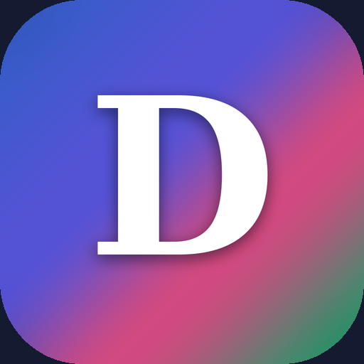
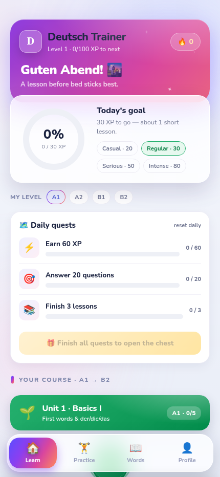
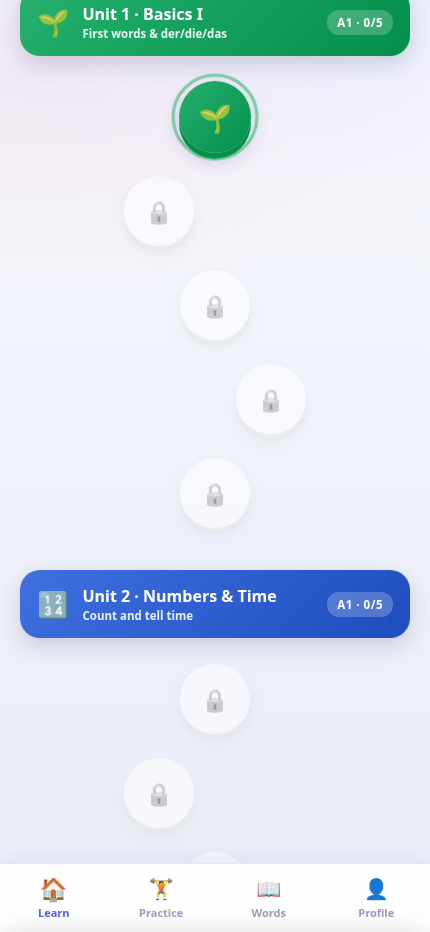
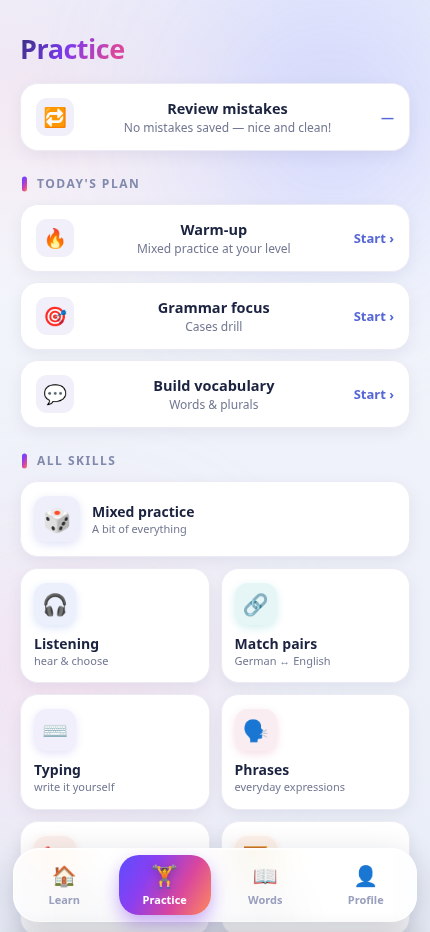
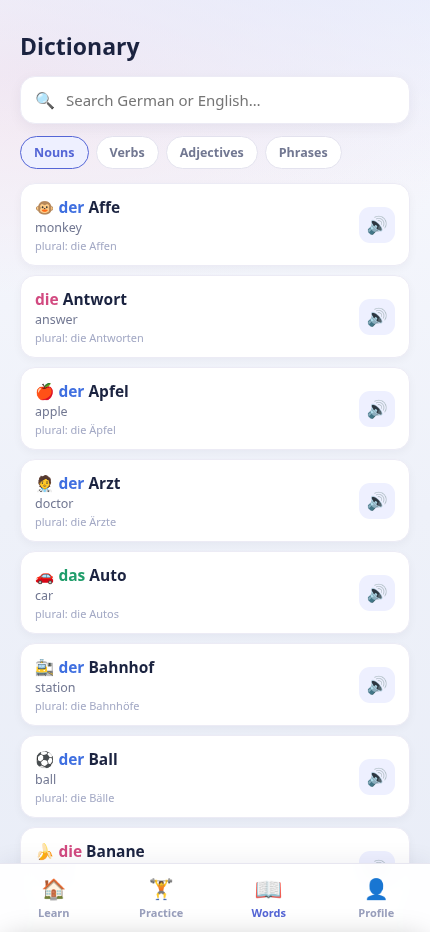
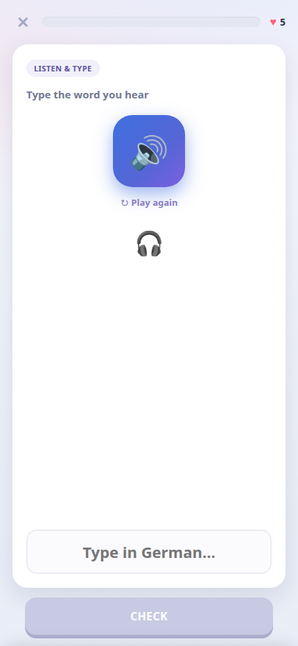
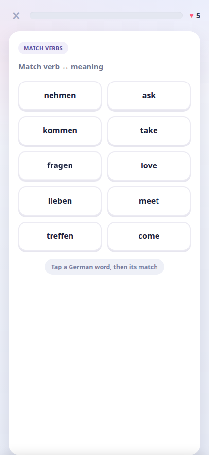
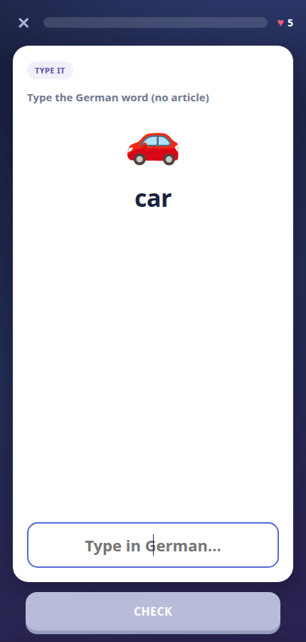
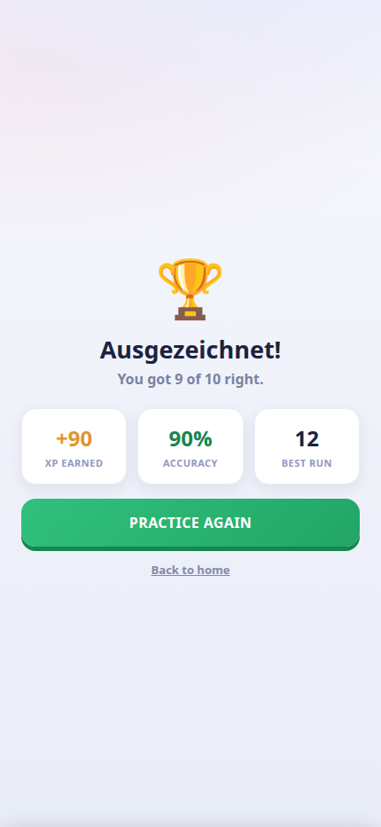

<div align="center">



# Deutsch Trainer

**A complete German course — A0 to C2 — that runs offline on your phone.**
A studio-d-style *Kursbuch* with Einheiten and Stationen, a grammar spine of 150+ lessons each with its own drills, spaced-repetition vocabulary, a verb trainer, and all four exam skills in Goethe formats. No account, no ads, no tracking.

[](https://bluerrror.github.io/deutsch-trainer/)
&nbsp;


</div>

---

## 📚 The Kursbuch — a real course, not a quiz app

The app is built like a coursebook. Each **Einheit** is a theme that works all four skills
around a grammar focus, in the order a classroom would take them:

| | Section | What happens |
| --- | --- | --- |
| 🚪 | **Einstieg** | the unit's key words, with audio |
| 🎧 | **Hören** | a dialogue or monologue read aloud, then comprehension questions, transcript unlocked after |
| 📖 | **Lesen** | an authentic-style text with a glossary and questions |
| 💬 | **Dialog** | a model conversation to shadow line by line |
| 📐 | **Grammatik** | the unit's grammar lessons — read, then drill them |
| ✏️ | **Übungen** | 12+ drills on exactly this unit's material |
| 🗣️ | **Sprechen** | a speaking task with Redemittel, a model answer and optional self-recording |
| ✍️ | **Schreiben** | content points, a phrase bank, word counter, saved draft, model answer |
| 🔊 | **Aussprache** | the sound this unit trains |
| 📝 | **Wortschatz** | the unit word list — one tap adds it to your review deck |
| ✅ | **Das kann ich auf Deutsch** | the can-do checklist that closes the unit |

Every fourth unit is a **Station**: a *Berufsbild* job profile, a *Magazin* culture page,
and mixed revision of the previous four units.

## 📐 Grammar is the spine

**150+ lessons from the alphabet to C2 style**, each built the same way: the rule, the
*reason* behind it, a table, a contrast card where two things get confused, real examples
with audio, a **warning box naming the mistake learners actually make**, and an inline
quick-check.

Then you **drill that exact lesson** — every lesson has its own 8-exercise set that
escalates from the plain case to the subtle one.

A few examples of how it teaches rather than lists:

- **Adjective endings** aren't three tables of 48 boxes — they're one principle:
  *the case must be visible exactly once.* If the article shows it, the adjective relaxes.
- **Verb position** is explained from *why* German can move things around (cases already
  mark who does what), so `Heute lerne ich` stops being arbitrary.
- **`soll` vs `will`** at C1 are taught as German's evidentials: who is making the claim,
  and whether the speaker believes it.

## 🎯 Know where you are, and what's next

- **Einstufungstest** — a laddered placement test that finds your level, sets the course,
  and lists the grammar topics you actually missed, each linked to its lesson.
- **Tagesplan** — one real lesson's worth of work each day: the next Kursbuch section,
  your due vocabulary, a grammar lesson with its drills, and your saved mistakes.
- **Readiness dashboard** — per-level progress across grammar, units, can-do statements
  and vocabulary, and a plain sentence telling you what is still blocking the next level.

## 🧠 Vocabulary that actually sticks

Unit word lists feed a **spaced-repetition deck** with eight intervals from one day to
five months. The Words screen shows the deck split into new / learning / consolidated /
secure, and the Tagesplan surfaces what's due.

## 🧾 Verb trainer

104 irregular and strong verbs with every form hand-checked: the three Stammformen,
full Präsens and Präteritum tables, Perfekt, Plusquamperfekt, Futur, Konjunktiv II and
the imperative — plus five drill types (Präteritum, Partizip II, haben-or-sein,
Konjunktiv II, the du/er stem change).

## 🎓 Exam trainer — all four skills in Goethe formats

- **Lesen** — texts, small-ad matching, true/false, multiple choice
- **Hören** — announcements, voicemail, radio, interviews, with slow replay
- **Schreiben** — content points, phrase bank, word counter, self-check, model answer
- **Sprechen** — prep/speak timers, examiner tips, a model to shadow, self-recording
- **Full mock exam** — the four parts back to back
- **Lesetexte** — an extensive-reading library with glossaries, questions, and one tap to
  add the glossary to your review deck

## 🧩 14 exercise types

Multiple choice · select-all · tap-the-word-in-the-sentence · multi-gap cloze ·
sort-into-buckets · letter scramble · sentence builder · match pairs · typing ·
dictation · listening · picture · conversation with a dialogue on screen ·
reading comprehension. Plus odd-one-out and false-friend traps.

## 🗣️ Living German

Slang and regional forms each paired with the neutral equivalent so you never use them in
the wrong place · 60 Redemittel grouped by what they *do* · multi-turn conversations from
the café to a diplomatic disagreement · idioms tagged by emotional colour · the
pronunciation rules that let you read any German word aloud.

## ⚙️ Built for real phones

Installable PWA · fully offline after first load (705 KB gzipped for the whole course) ·
explanations in **English or Persian (فارسی)** · four German voices · safe-area and
landscape layouts · tablet and desktop breakpoints · honours *reduce motion* ·
your progress never leaves your device.

## 📱 Screenshots

<div align="center">

&nbsp;

&nbsp;

&nbsp;

&nbsp;

&nbsp;

&nbsp;

&nbsp;

</div>

## 🚀 Install on your iPhone (≈2 minutes)

1. Open **Safari** on your iPhone and go to **[bluerrror.github.io/deutsch-trainer](https://bluerrror.github.io/deutsch-trainer/)**.
2. Wait a few seconds so it caches for offline use.
3. Tap the **Share** button (□↑) → **Add to Home Screen** → **Add**.

You'll get a **"D" icon** that opens **fullscreen** and **works offline**.
On Android/Chrome, use the **⋮ menu → Install app**.

## 🤖 Install on Android

Download the ready-made app: **[deutsch-trainer.apk](https://github.com/Bluerrror/deutsch-trainer/releases/latest/download/deutsch-trainer.apk)** (from the [Releases](https://github.com/Bluerrror/deutsch-trainer/releases) page).

1. Open the downloaded file on your phone.
2. If asked, allow installing from this source.
3. Launch **Deutsch Trainer** from your app drawer — fullscreen, offline-capable.

## 🛠️ Tech

- **Vanilla HTML, CSS and JavaScript. Zero dependencies, no build step.**
- `index.html` is the app; all content lives in plain data files beside it:

| File | What's in it |
| --- | --- |
| `kurs_a0…c2.js` | the Kursbuch — Einheiten and Stationen per level |
| `grammar.js`, `gram_a1…c1.js` | grammar lessons |
| `drill_core.js`, `DRILL_*` in each pack | per-lesson exercise sets |
| `verbs.js` | irregular verb tables |
| `vocab.js`, `goethe.js` | the dictionary and a Goethe-aligned wordlist |
| `bank.js`, `advanced.js`, `spoken.js` | authored questions, B1–C2 grammar data, slang & Redemittel |
| `exams.js`, `read1.js` | four-skill exam tasks, extensive-reading library |
| `fa.js` | the Persian pack |

- Installable **PWA**: [`manifest.webmanifest`](manifest.webmanifest) + a service worker ([`sw.js`](sw.js)).
- **Web Speech API** for pronunciation, **MediaRecorder** for speaking practice,
  **Web Audio API** for sound effects, `navigator.vibrate` for haptics.
- Hosted free on **GitHub Pages**.

## 💻 Run locally

```bash
git clone https://github.com/Bluerrror/deutsch-trainer.git
cd deutsch-trainer
python3 -m http.server 8000      # then open http://localhost:8000
```

> Open via a local server (not `file://`) so the service worker and manifest load correctly.

## 📄 License

Released under the [MIT License](LICENSE).

<div align="center">
<sub>Made with ❤️ for German learners · <a href="https://bluerrror.github.io/deutsch-trainer/">Open the app →</a></sub>
</div>
